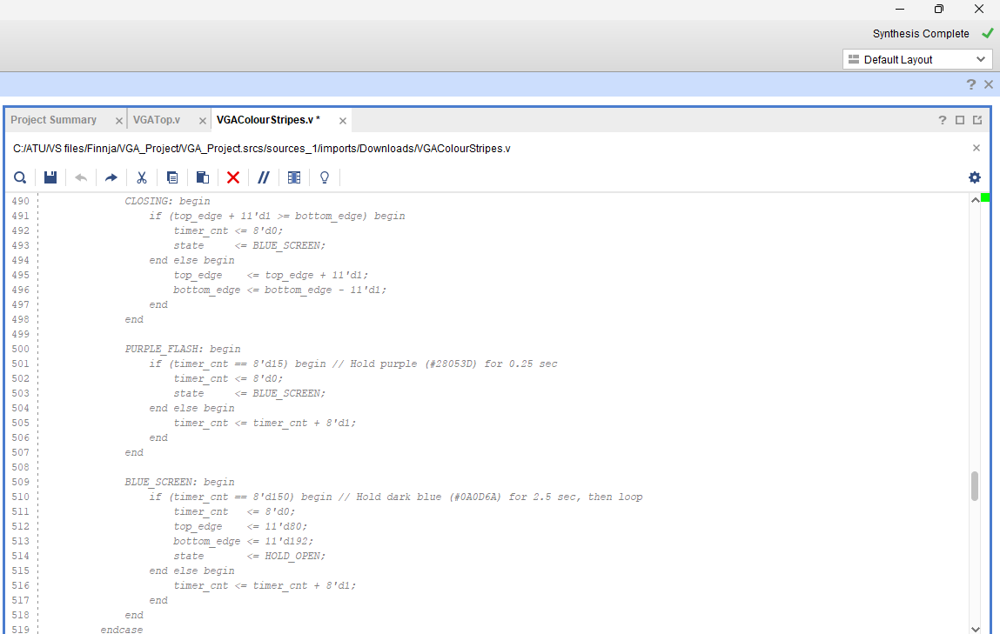
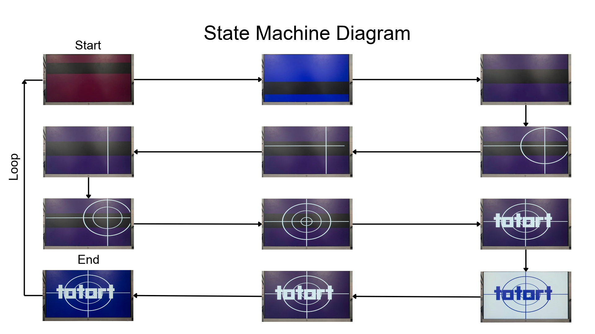

This project is a simplified version of the intro of one of my favourite tv shows, recreated with a FPGA based VGA graphics driver using Verilog HDL. It started with a supplied template which I then adapted.

## **Template VGA Design**
### **Project Set-Up**
I used Vivado to set up the project and work with the Verilog files. The design was run on the Basys3 board, which was connected to a VGA port on the monitor. Below is a picture showing the structure of the template code, which I kept in full, just editing the files.

## **Template Code**
The supplied code displayed differently coloured vertical stripes. It was split into two modules, VGATop and VGASync. VGATop includes the design code, while VGASync handles timing and keeps track of the displaying process, where one line is drawn at a time. 

### **Simulation**
A testbench was provided to simulate the design in Vivado. I used this to test the supplied code, but did not get too comfortable with it which is why I relied more heavily on testing the code on the physical board.
### **Synthesis**
Synthesis is used to turn Verilog Code into a design that can be run on FPGA. I had a clock configuration issue at first but managed to get it working and complete a synthesis run.

## **My VGA Design Edit**
My idea was to make a simplified version of a TV show intro. I wanted the screen to change through different images while including some of the characteristic animations.
### **Code Adaptation**
I kept the main VGA setup from the supplied code and adapted it to create my animations. I used the row and column positions to draw the coloured areas and elements like rings and text, and used a state machine to move through the animations.
The code also includes earlier versions of the design, which I left commented out. These show how the graphics started with a simpler colour cycle and opening/closing slit effect before being built into the longer final version. 

I used AI tools to help me understand and adapt parts of the code and to work through problems. I then verified the changes by trying them on the board.
### **Simulation**
I had the testbenc available but mainlyrelied on the physical board to checkprogress,since I found the waveforms abstract and difficult to understand. Looking back I would spend more time on learning how to use the simulator because I wasted a lot of time by repeatedly uploading the code. 
### **Synthesis**
I ran synthesis on the adapted design, where I encountered multiple problems having to do with the changes I made to the file and its name, since Vivado was now unable to find it. I fixed this by keepig the old name, even though its not very descriptive of my personal project.
### **Demonstration**
The final animation worked on the Basys3 board and displayed correctly on the monitor. It moved through the different stages and ten returned to the start, looping without needing to reset the board.
<video width="100%" controls>
  <source src="docs/assets/images/VGAProjectDemo.mp4" type="video/mp4">
  Your browser does not support video playback.
</video>
### **State Machine Diagram**
I made this diagram to show the order of the different screens in the animation. It starts with three colour stages and then moves on to adding lines and rings before displaying the show title in a flashing manner.

### **Problems I ran into**
At the beginning I had problems displaying the sample code to the monitor. I figured out that it was due to incorrect clock configuration. I compared my setup to the one of my classmates and fixed the issue.
I also had issues with the animations at first since I was a state machine and a sub state machine, which changed the colour frames correctly but would only perform the animation on the first one.

## **Progress Documentation**
### **Week 1**
Set up Github Pages for documentation during project creation and presentation of the final project
Uploaded a demo for vertical stripes in different colours to board, got error message that the ratio is not suitable for display

### **Week 2**
Figured out that display wasn't working due to incorrect clock configuration
Changed horizontal stripes to vertical stripes by replacing col variable with row variable
Adjusted the ratio to ensure all stripes are being printed, none are out of range
Played around with the colours and stripe sizes to figure out possibilities
Came up with code to change individual pixels 

### **Later development**
After getting the basic design working I moved on to the specific TV intro I was aiming for. I added the different colour stages, lines, rings and title frames, then tested the finished version on the board.

### **Conclusion**
I was able to use the supplied VGA project and adapt it into my own version, which I then got running on the Basys3 board. I learned how the row and column positions can be used to change specific pixels and how to draw graphics. I also learned how a state machine can be used in a practical context by changing the animation frames.
I found some parts challenging but eventually figured them out by consulting my classmates and the internet. Overall, I am happy with my final result, it is displaying the way I wanted it to and brings a bit of nostalgia into my college environment. 
